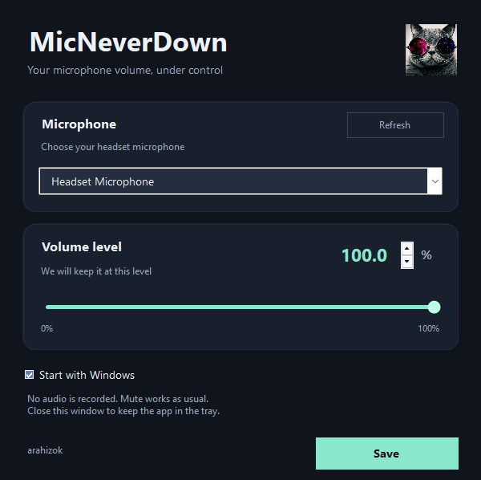

# MicNeverDown 1.3.0 😎

By **arahizok**.

If you’re tired of your microphone constantly lowering its volume, there’s a solution. MicNeverDown checks your microphone’s volume and restores the level you choose.

A small Windows tray app with a dark settings window, a cat icon, and English and Russian interfaces.



## Download and run

Requires **Windows 10 or 11 with .NET Framework 4.8**. Administrator rights and additional runtime packages are not required.

1. Open this repository’s **Releases** section and download **`MicNeverDown-v1.3.0.zip`**.
2. Extract the ZIP into a permanent folder you can write to. Do not run the app from inside the ZIP.
3. Run **`MicNeverDown.exe`**.
4. Select your microphone and the volume you want to keep, then click **Save**.
5. Optionally enable **Start with Windows**.

Closing the settings window leaves the app running in the Windows system tray. Double-click the cat icon to open settings again. If the icon is hidden, open the tray’s hidden-icons menu.

The source archive and GitHub’s automatic **Source code** downloads are for building the app; use the ZIP named above for the ready-to-run version.

## Change the language

English is the default. Right-click the cat in the system tray, open **Language**, and choose English or Russian (shown in its native language). The settings window, tray menu, and app messages use the selected language. Your choice is saved locally and remembered when you restart the app. Device names and messages supplied by Windows or a driver may use your system language.

## Features

- Holds one selected microphone at a volume from **0 to 100%**.
- Checks the system volume every **150 ms** and restores the configured level after changes in either direction.
- Includes a volume slider and precise **0.1%** input.
- Supports **Pause** and **Resume** from the tray menu.
- Waits for the same microphone to reconnect, checking every **2 seconds**; it does not switch to another microphone automatically.
- Preserves the microphone’s mute state and leaves headphone volume and other microphones unchanged.
- Offers optional startup for the current Windows user, without a service, scheduled task, or administrator privileges.
- Reopening the app shows the existing instance instead of starting another guard.

The volume may briefly change before the next check. Microphone processing inside Discord, games, or a driver is configured separately. If Windows assigns a new device ID after a USB-port or driver change, select the microphone again.

MicNeverDown keeps the configured level; it does not provide noise suppression, automatic gain control, or audio effects.

## Tray controls

- **Microphone and volume…** opens the settings window.
- **Pause / Resume** temporarily stops or resumes volume enforcement.
- **Start with Windows** enables or disables startup.
- **Language** changes the interface language.
- **Exit** stops the current session.
- **Disable startup and exit** also removes the app’s startup shortcut.

Changes in the settings window take effect when you click **Save**. Closing it without saving leaves the microphone settings unchanged.

## Local data and privacy

The app does **not** record or process audio. It has **no network features, analytics, telemetry, or automatic downloads**.

Local files are stored in a **`data`** folder beside the EXE:

- `settings.xml`: the selected microphone’s Windows device ID, display name, and target level.
- `ui.xml`: the selected interface language.
- `status.xml`: the current guard state, microphone details, volume, mute state, and process ID.
- `last-error.txt`: the latest diagnostic error, if an error occurs.

These files remain on your computer. Diagnostic errors can include local paths or device details, so review the `data` folder before sharing it. Personal settings and runtime files are excluded from the release and source packages.

If you move the EXE, disable startup first and enable it again from the new location. Keep the `data` folder with the EXE if you want to retain your settings.

## Optional helper scripts

The EXE works on its own. The release ZIP also includes:

| File | Purpose |
| --- | --- |
| `Install.cmd` | Installs or updates a copy under your Documents folder at `Codex\Utilities\MicNeverDown`, then enables startup. |
| `Settings.cmd` | Opens the installed copy, or the portable copy in the current folder. |
| `Stop.cmd` | Stops the app and disables startup. |
| `Uninstall.cmd` | Removes the installed copy and its known local settings files. The portable release folder is kept. |

Startup uses a shortcut in the current user’s Windows Startup folder. The app creates it directly through the Windows Shell interfaces `IShellLinkW` and `IPersistFile`.

## What changed in 1.3.0

- Added English and Russian interface languages, with English as the default.
- Added a language switch to the tray menu and a saved local language preference.
- Updated the public documentation and screenshot to English.
- Kept the dark design, microphone settings, volume guard, mute handling, and startup controls.

## Build from source

Use **PowerShell 7 on Windows** with its bundled Roslyn compiler libraries. The build uses locally installed Microsoft .NET Framework reference assemblies. It does not download dependencies or restore packages.

From the source folder:

```powershell
pwsh -NoProfile -File .\Build.ps1
```

The result is **`bin\MicNeverDown.exe`** and **`bin\build-info.json`**. The build information records versions and SHA-256 hashes for compiler files, framework references, source files, resources, and the resulting EXE.

The build is deterministic for identical inputs. Reproducing the published EXE requires matching the source, compiler, and framework file hashes in `build-info.json`; different Windows, .NET Framework, or PowerShell versions can produce a different hash.

`BuildSupport.cs` is a build helper and is not part of the running application.

Run the core tests with:

```powershell
pwsh -NoProfile -File .\tests\Test-Core.ps1
```

The localization tests can be run after building:

```powershell
pwsh -NoProfile -File .\tests\Test-Localization.ps1 -ApplicationPath .\bin\MicNeverDown.exe
```

See **`VALIDATION.md`** for the checks performed on this version and their limits.

## Command-line options

| Option | Purpose |
| --- | --- |
| `--settings` | Opens settings, or asks the running instance to show them. |
| `--background` | Starts without opening settings when a configuration exists. |
| `--pause` / `--resume` | Pauses or resumes the running guard. |
| `--stop` | Stops the running instance. |
| `--enable-startup` / `--disable-startup` | Enables or disables startup. |
| `--disable-startup --stop` | Disables startup and stops the running instance. |
| `--list <xml-file>` | Writes the available capture devices to an XML file. |
| `--configure <device-id> <level-0-to-1>` | Saves a microphone configuration while the app is closed. |

## Checksums and executable signing

Release checksums are provided in **`SHA256SUMS.txt`**. They help verify that a download matches the published file; they do not establish that software is free of bugs or malicious behavior.

The executable is **unsigned**. Source code, build information, and validation notes are provided for independent review. No antivirus result or detection-free guarantee is claimed.
